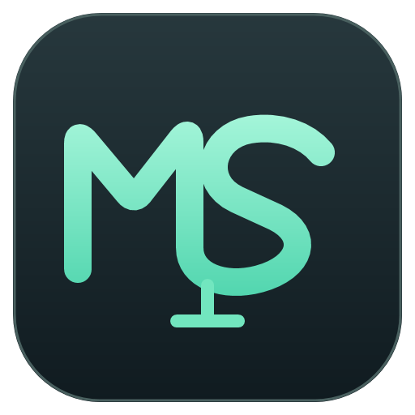

# Mic Studio

Windows 原生麦克风调节软件，使用 C# / WPF / .NET 10。面向可选择输入设备的录音、会议、直播、通话软件。界面以设备、系统音量、数字增益和真实电平为主；高级参数按需展开。0.3.0 起关闭窗口默认收进托盘继续运行，并支持参数记忆、登录启动和简体中文 / English 界面；0.4.0 增加语音优先降噪、自动底噪跟踪、实时音高/电话/爆炸麦主题；0.4.1 按用户反馈恢复简洁 MS 字母图标。

[下载发行版](https://github.com/haiyang172/Mic-studio/releases) · [MS 图标源文件](assets/branding/) · [0.4.1 更新说明](docs/release-0.4.1.md)

## 使用

双击 `MicStudio.exe`。发行包自带运行时，不需要 SDK。可使用便携目录，也可运行 `MicStudio.Setup.exe` 安装到当前用户。默认不打开麦克风、监听或录音；普通操作无需管理员。

1. 顶部选择真实麦克风。
2. **系统音量**和**静音**直接改变该 Windows 录音端点，影响其他使用该麦克风的软件。
3. 选择处理方式：
   - **虚拟输入 · CABLE**：软件自动匹配可用的 CABLE 收发端，点击开始处理即可；其他软件选择设备页显示的输入（通常是 `CABLE Output`）。驱动重装导致旧设备编号失效时自动修复，无需手动选发送端。支持全部内置效果。停止或退出会中断本地发送。
   - **系统输入 · APO**：需要独立 Equalizer APO，并在官方工具中绑定目标录音端点；只支持增益和 EQ。其他软件仍选原麦克风，是否经过 APO 需实际验证。退出 Mic Studio 后 APO 可能继续生效。
4. **虚拟输入模式**运行时调整增益、EQ、主题或效果，声音实时更新，无需点应用或重新开始。主按钮在“开始处理 / 停止”之间切换。停止时只保存参数，不自动打开麦克风。
5. **系统 APO 模式**保留设备页的手动预览/更新流程，不承诺实时控制第三方系统组件。不要把重复 APO 和本地 EQ 叠加到同一个麦克风。
6. 点击窗口关闭按钮默认收进托盘，正在处理的声音和虚拟线路发送不中断。托盘菜单可打开窗口、暂停/继续、停止全部本地音频或明确退出；退出时才释放本地音频。可在设置页关闭“关闭到托盘”。
7. 设置页可切换 **简体中文 / English**，更改立即重建界面并记住选择，不停止音频，也不改变增益、EQ、主题或设备。English 覆盖页面、按钮、状态、提示与参数错误；Windows 提供的设备名称按原样显示。
8. “登录 Windows 后启动 Mic Studio”和“登录启动后自动开始处理”是独立选项。登录启动始终进入托盘、不弹出主窗口；自动开始处理默认关闭，手动启动永远不会自动打开麦克风。
9. 效果页的降噪可开“自动跟踪底噪”和“语音优先”；创意声音可选音高、电话/电台和爆炸麦等主题。氢气音/萝莉音是音高预览，不保留共振峰；AEC 与房间混响抑制尚未提供。

虚拟输入可用于任意支持选择音频输入的应用，Discord 只是其中一个例子。软件不修改系统默认设备或其他应用的配置。

## 驱动

发行包包含原始完整 **VB-CABLE Pack45** ZIP 和原始文件，来源 [VB-Audio](https://vb-cable.com)。VB-CABLE 是 Donationware，欢迎在[官方页面](https://vb-audio.com/Services/licensing.htm)支持作者。只捆绑标准 VB-CABLE，不包含 A+B / C+D。

**设备**页显示驱动文件版本、两个端点状态及本地包编号；支持检查官网更新、重新下载和打开官方安装器进行安装/更新/重装。联网只发生在主动检查或下载时。安装器签名验证后才发起 UAC；用户确认官方安装步骤，程序不静默重启。包编号与已安装文件版本分别显示，不将两者直接比较。卸载 Mic Studio 保留独立驱动，并清理 Mic Studio 自己创建的登录启动项。

Equalizer APO 不属于 VB-CABLE 驱动，不是虚拟输入模式的依赖。需要系统 APO 模式时可从[官方项目](https://sourceforge.net/projects/equalizerapo/)安装。

## 功能

- Core Audio 端点枚举、稳定 ID、拔插通知、断线停止，不自动换麦克风。
- 输入数字增益 −24～+30 dB、输出衰减 −24～0 dB，主动测量峰值/RMS 和讲话增益建议。
- 八段 EQ：一个总开关，默认 / 已保存主题 / 自定义可直接选择，六个常用音色滑条直接调节。频率、Q、高低通与曲线拖动放在默认收起的“高级功能”。新默认八段启用，高通 20 Hz、低通 20 kHz（随低采样率适配）；旧主题关闭的频段保留原状态，调节该频段时启用。
- “效果开关”统一控制处理效果；与麦克风静音分开。顶部只保留“恢复默认”，当前预设显示“无 / 预设名 / 自定义”。恢复默认保留个人主题、设备与偏好。
- 本地 DSP：固定或自动跟踪底噪的 STFT Wiener 频谱降噪、语音优先保护、压缩、柔和扩展器、采样峰值限幅、饱和、机器人环形调制、回声、混响、电话/电台带限和实时音高变调。
- 平直、自然、清晰、温暖预设；个人新建、复制、重命名、删除、收藏、安全 JSON 导入导出。
- 创意声音简易入口：温暖、爆炸麦、机器人、回声、空间、电话/电台、氢气音、萝莉音、怪兽/低沉，选择主题后开启，强度用百分比调节；细节可在高级功能调整，自定义组合关闭再开启仍保留。
- 简洁的 MS 字母图标：M 为 Mic、S 为 Studio，薄荷绿连笔和短支架呼应麦克风；16/20/24 像素省略细小支架，保留字母识别度。
- 30 秒本地录音、显式耳机回放、DSP 前源录音及同源离线 A/B；整段 RMS 匹配并保留峰值余量，不等于 LUFS 或真峰值处理。
- 参数、设备选择、主题、语言、托盘与登录启动偏好写入本地工作区；旧 0.2.x 工作区自动迁移。设备按稳定 ID 恢复，断开时保留选择，不自动换成其他麦克风。
- 关闭窗口默认收进托盘并保持本地处理和虚拟线路发送；托盘提供打开、暂停/继续、停止全部本地音频和明确退出。真正退出会停止音频并释放资源。
- 可选当前用户登录启动，启动时进入托盘；登录启动与自动开始处理分别控制。卸载清除 Mic Studio 创建的启动项，不影响其他程序。
- 简体中文 / English 界面，记住语言选择；切换语言不停止音频、不改变参数。Windows 提供的设备名称按原样显示。
- 独立耳机监听、普通权限启动、按需 UAC、浅/深主题、脱敏诊断预览。

0.5.0 开发预览新增外放播放参考 AEC 和独立的持续啸叫静音保护，适用于本地 DSP / CABLE 路线，包括 Discord 选择 CABLE Output 时的外部监听。默认优先使用当前 Discord 的唯一物理输出作为参考，再使用系统物理默认输出；不保存或上传播放内容。没有参考时明确显示等待或未就绪，不把降噪、门限或限幅当作消回声。啸叫保护在效果旁路时仍生效，触发后需停止并重新开始。该算法经过合成信号测试，真实房间、不同 USB 时钟、扬声器失真和 Discord 麦克风测试仍需试听验收；不承诺完全消除外放回声。

不包含 RNNoise 人声分离、自然共振峰保持、通用 VST 宿主或房间混响抑制。0.4.0 的氢气音/萝莉音是延迟线实时变调，不保留共振峰。降噪不保证消除说话中的键盘声或补回遮挡信息。

自有 Windows APO 现已有独立原生 COM DLL、增益/八段 EQ/限幅、参数通道和受控安装/还原预览，见 [P4 开发预览验证](docs/validation/p4-development-preview.md)。本版未签名开发组件不自动注册；可信签名、`audiodg.exe` 实际加载和真实系统响应仍未验收，因此尚不标为完整 P4。第三方 Equalizer APO 接入保留。主界面“自研 APO（预览）”只有完成可信部署与绑定后才允许发送参数，明确显示音频待验证。

## 开发

SDK 锁定于 `global.json`。本地若有 `.tools/dotnet/dotnet.exe`，脚本优先使用；否则使用系统 SDK。

```powershell
.\scripts\Build.ps1
.\scripts\Build-NativeCpp.ps1
.\scripts\Stage-NativeRuntime.ps1
.\scripts\Test.ps1
.\scripts\Test-UI.ps1
.\scripts\Publish.ps1
```

也可双击 `Build.cmd` 或 `Run.cmd`。发行输出在 `dist/`，含便携 ZIP、原生安装器、SHA256。Windows CI 构建并上传包，不自动发布 Release。依赖锁文件纳入版本控制。源码不包含 SDK、私人录音、日志、个人设置或驱动二进制。

## 验证边界

算法、配置保护、离线文件处理、驱动包校验和安装器路径安全由自动测试覆盖。当前电脑普通权限检测到 USB PnP 麦克风及 CABLE 两端。虚拟线路中已用合成信号验证传输与 −6.000 dB 增益变化、快速启停和并发停止。

0.2.0 的 P1 验证覆盖：同一采集会话中实时增益、EQ、EQ 总开关和连续 60 次更新；29 项实际 WPF 控件检查，三个窗口尺寸的七页及展开高级功能。0.2.1 覆盖虚拟线路自动重连。0.3.0 的 P2 验证覆盖：43 项 WPF 控件事件检查、27 种中文布局和 27 种英文布局、七页英文界面无未翻译文本、关闭到托盘、托盘菜单、语言切换与恢复、启动命令和真实 HKCU 启动项的写入/移除自测。0.4.0 的 P3/P5 验证覆盖：40 项 Core 合成测试（含自动底噪、语音优先和 300→约 600 Hz 的实时音高移调）、47 项 WPF 控件检查、27 种中文/27 种英文布局、英文未翻译汉字 0。0.4.1 恢复 MS 字母图标，16/20/24/32/40/48/64/128/256 九层 ICO 重新生成；P4 只提交设计与阻塞说明，未安装或验证自有系统 APO。详见 [P3/P5 验证记录](docs/validation/p3-p5.md)、[P2 验证记录](docs/validation/p2-background.md) 和 [P1 验证记录](docs/validation/p1-live-controls.md)。

真实物理麦克风讲话、主观音质、系统 APO 实际生效、外部软件实际接收、一小时连续处理、睡眠唤醒以及完整安装/卸载仍需对应的实际验收，不由合成测试替代。窗口在三个实际 WPF 尺寸检查；未宣称完成所有系统 DPI 与跨显示器切换。

详细记录见 `docs/validation/`；架构与第三方声明见 `docs/architecture/` 和 `THIRD_PARTY.md`。旧桌面原型保留在原目录，没有被新工程覆盖。
